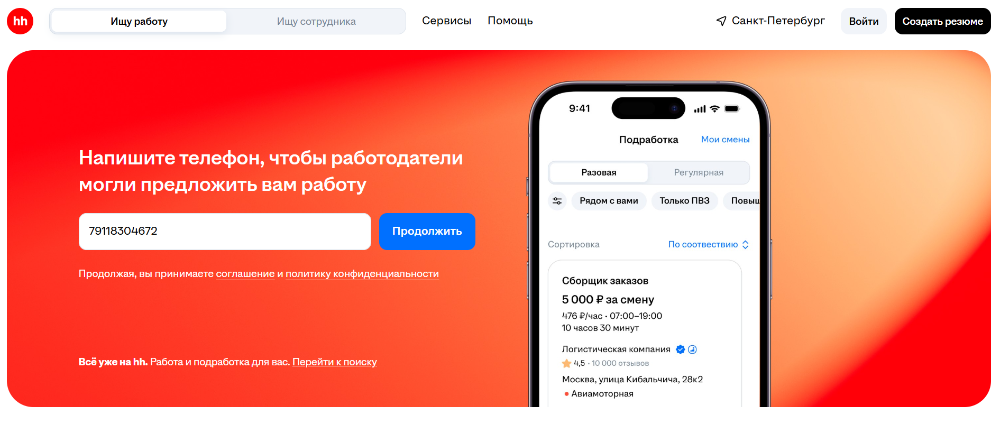
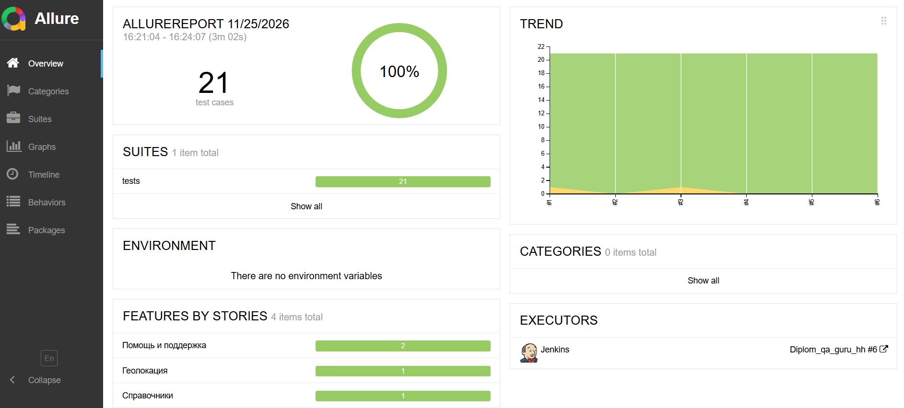
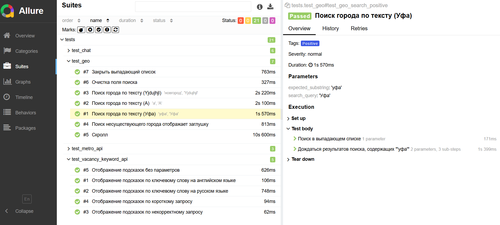
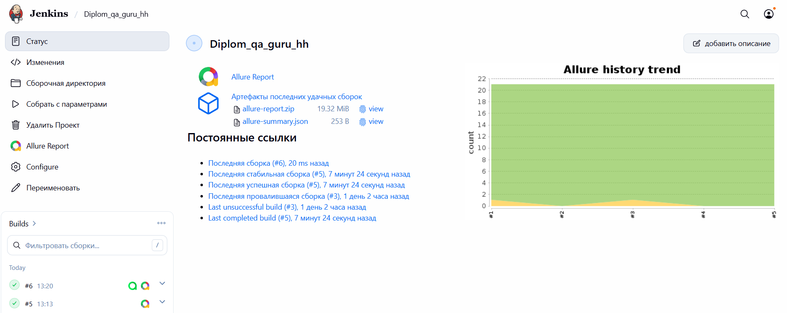
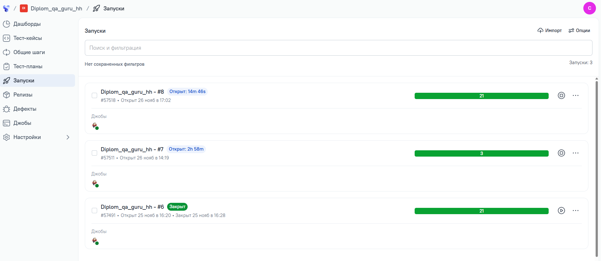
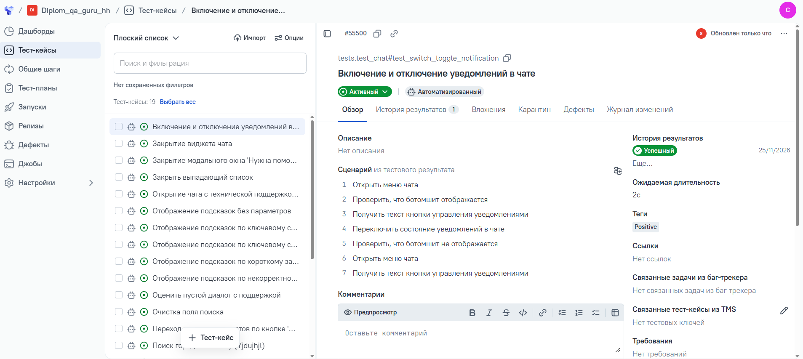

<p align="center">
  
</p>

# hh.ru UI & API Test Automation

Дипломный проект по автоматизации UI- и API-тестирования веб-приложения [hh.ru](https://hh.ru).



* **Сборка проекта в Jenkins:** [Перейти в Jenkins](<https://jenkins.qa.guru/job/Diplom_qa_guru_hh/>)
* **Отчет Allure Report:** [Открыть отчёт](<https://jenkins.qa.guru/job/Diplom_qa_guru_hh/6/allure/>)

## 📑 Содержание

- [Используемый стек](#-используемый-стек)
- [Что тестируется](#-что-тестируется)
- [Структура проекта](#-структура-проекта)
- [Запуск проекта](#-запуск-проекта)
- [Формирование Allure-отчёта](#-формирование-allure-отчёта)
- [Запуск в CI/CD (Jenkins)](#-запуск-в-cicd-jenkins)
- [Интеграция с Allure TestOps](#-интеграция-с-allure-testops)
- [Уведомления в Telegram](#-уведомления-в-telegram)
- [Демонстрация выполнения автотеста](#-демонстрация-выполнения-автотеста)

## 🛠 Используемый стек

* **Python** - язык программирования.
* **Selenium WebDriver** - управление браузером, эмуляция действий пользователя.
* **Pytest** - запуск тестов, фикстуры, параметризация.
* **Requests** - отправка HTTP-запросов, проверка статус-кодов.
* **JSON Schema** - валидация структуры ответов и типов данных.
* **Selenoid** - запуск браузера в изолированных Docker-контейнерах.
* **Jenkins** - автоматизированный запуск тестов.
* **Allure Report** - интерактивные отчёты со скриншотами, логами и видеозаписями.
* **Allure TestOps** - управление тест-кейсами и интеграция результатов автотестов с TMS.

## 📋 Что тестируется

<details>
<summary><b>Покрытые функциональные модули (UI и API)</b></summary>

* **UI:** проверки геолокации и виджета чата.
* **API:** проверки эндпоинтов справочника метро и поисковых подсказок.

</details>

## 📁 Структура проекта

<details>
<summary><b>Дерево директорий и файлов</b></summary>

```text
qa_guru_diplom_work_hh/
├── core/                       
│   └── browser.py                  # Обертка над WebDriver (ожидания, клики, скролл)
│
├── media/
│   └── gif/                        # Гифки демонстрации прогона тестов
│   └── images/                     # Скриншоты продукта, отчетов, сборок и т.д.
│
├── pages/
│   ├── components/                 # Переиспользуемые UI-компоненты
│   │   ├── chat_widget.py          # Виджет чата поддержки
│   │   ├── geo_dropdown.py         # Выпадающий список выбора ГЕО
│   │   ├── header.py               # Шапка (хэдэр)
│   │   └── help_modal.py           # Модальное окно поддержки
│   ├── base_page.py                # Базовый класс страниц
│   └── main_page.py                # Главная страница сайта
│
├── schemas/                        # JSON-схемы
│
├── tests/                          # Автотесты
│   ├── test_chat.py                # Тесты чата
│   ├── test_geo.py                 # Тесты ГЕО
│   ├── test_metro_api.py           # АПИ тесты справочника метро
│   └── test_vacancy_keyword_api.py # АПИ тесты подсказок 
│
├── utils/                          # Вспомогательные утилиты и хелперы
│   └── attach.py                   # Модуль для добавления вложений
│ 
├── .env                            # Переменное окружение
├── conftest.py                     # Фикстуры Pytest и настройка браузера с подключением к Selenoid
├── pytest.ini                      # Конфигурация Pytest
├── requirements.txt                # Зависимости проекта
└── README.md                       # Документация проекта
```
</details>

## 💻 Запуск проекта
<details open>
<summary><b>Установка и настройка</b></summary>

1. Склонируйте репозиторий и перейдите в папку проекта:
   ```bash
   git clone https://github.com/corvuscorvx/qa_guru_diplom_work_hh.git
   cd qa_guru_diplom_work_hh
   ```

2. Создайте и активируйте виртуальное окружение `.venv`:
   ```bash
   python -m venv .venv
   # Windows:
   .venv\Scripts\activate
   # Linux / macOS:
   source .venv/bin/activate
   ```

3. Установите зависимости:
   ```bash
   pip install -r requirements.txt
   ```

4. Создайте файл `.env` в корне проекта и укажите параметры подключения:
   ```
   BASE_URL=https://spb.hh.ru/
   SELENOID_URL=<адрес_вашего_selenoid>
   SELENOID_LOGIN=<логин>
   SELENOID_PASSWORD=<пароль>
   ```

</details>

<details open>
<summary><b>Запуск тестов</b></summary>

Перед запуском убедитесь, что виртуальное окружение `.venv` активировано и вы находитесь в корневой папке проекта.

> **Примечание:** Очистка старых логов и сохранение результатов для отчёта (`--clean-alluredir --alluredir=allure-results`) уже настроены по умолчанию в файле `pytest.ini` и применяются автоматически при любом запуске.

#### 1. Запуск всех тестов
Запуск полного набора UI и API проверок из директории `tests`:
```bash
pytest -v tests
```

#### 2. Запуск тестов по маркам (`-m`)
В проекте используется двойная маркировка тестов: по **типу тестирования** и по **функциональному модулю**.

**Доступные маркеры:**
* `ui` - тесты пользовательского интерфейса
* `api` - тесты бэкенда (API)
* `metro` - функционал выбора/поиска метро
* `keyword` - функционал поисковых подсказок (саггестов)
* `chat` - функционал виджета чата поддержки
* `geo` - функционал геолокации

**Примеры запуска:**
```bash
# Только API-тесты (выполняются без запуска браузера)
pytest -v tests -m api

# Только UI-тесты в фоновом (headless) режиме
pytest -v tests -m ui --headless

# Тесты конкретного функционального модуля (например, чат или гео)
pytest -v tests -m chat

# Комбинированный запуск по двум маркам (например, только UI-тесты чата)
pytest -v tests -m "ui and chat"
```

#### 3. Запуск конкретного теста
Чтобы запустить отдельный тестовый сценарий, укажите путь к файлу и имя функции через `::`:
```bash
pytest -v tests/<имя_файла>.py::<имя_теста>
```

**Полезные ключи запуска:**
* `-m` - фильтрация тестов по маркерам (поддерживает логические операторы `and`, `or`, `not`).
* `-v` / `-vv` - подробный вывод названия и статуса тестов (с `-vv` отображается полный diff при падении `assert`).
* `--headless` - запуск браузера без графического интерфейса.

</details>

## 📊 Формирование Allure-отчёта

<details open>
<summary><b>Просмотр отчётов локально и в CI</b></summary>

Поскольку сбор результатов настроен в `pytest.ini`, после каждого прогона свежие артефакты (шаги теста, логи API-запросов, скриншоты и видеозаписи падений) автоматически сохраняются в директорию `allure-results`.

Чтобы сгенерировать и открыть интерактивный HTML-отчёт в браузере локально, выполните:
```bash
allure serve allure-results
```
> **Важно:** Требуется предварительно установленная **Java** и **Allure Commandline**.



</details>

## 🔧 Запуск в CI/CD (Jenkins)

<details open>
<summary><b>Автоматизированный прогон и параметры сборки</b></summary>

Проект интегрирован с сервером непрерывной интеграции **Jenkins** для автоматизированного запуска автотестов.

**Как устроен пайплайн сборки:**
1. **Получение кода и окружения:** Jenkins клонирует актуальную ветку репозитория, разворачивает виртуальное окружение и устанавливает зависимости из `requirements.txt`.
2. **Параметризованный запуск:** Сборка поддерживает выбор области тестирования через параметр `${MARKER}` (позволяет в один клик запустить прогон по конкретной марке: `ui`, `api`, `chat`, `geo`, `metro`, `keyword` или выполнить полный регресс).
3. **Удалённый запуск браузеров (Selenoid):** Графические UI-тесты выполняются в изолированных Docker-контейнерах на удалённом кластере **Selenoid** с записью видео сессий.
4. **Безопасность:** Учётные данные, токены и параметры подключения к Selenoid передаются через защищённые переменные окружения Jenkins (Credentials) и не хранятся в открытом виде в репозитории.
5. **Публикация отчёта:** После завершения тестов плагин Allure Jenkins автоматически формирует веб-отчёт и прикрепляет его к текущей сборке.


</details>

## 🧪 Интеграция с Allure TestOps

<details open>
<summary><b>Управление тест-кейсами и аналитика запусков</b></summary>

Проект интегрирован с системой управления тестированием **Allure TestOps** для централизованного хранения тестовой документации, трекинга результатов и аналитики качества.

**Возможности интеграции:**
* **Автоматическая синхронизация (Live-документация):** Тест-кейсы в Allure TestOps автоматически создаются и обновляются на основе кода автотестов (используются декораторы `@allure.feature`, `@allure.story`, `@allure.title`, `@allure.tag`, `@allure.step`).
* **Передача результатов из CI:** После завершения прогона в Jenkins результаты выполнения (`allure-results`) автоматически отправляются в проект Allure TestOps.
* **Запуск тестов из TMS:** Настроена двусторонняя связь с Jenkins, позволяющая формировать тест-планы и запускать выборочные автотесты прямо из интерфейса Allure TestOps.
* **Аналитика и история:** Отслеживание стабильности тестов (Flaky-тесты), истории падений по сборкам и общего покрытия функционала.



</details>

## 📲 Уведомления в Telegram
В конфигурацию сборки Jenkins добавлен шаг отправки отчёта в **Telegram** через Bot. По завершении прогона скрипт формирует краткую сводку (статус сборки, статистику пройденных/упавших тестов и ссылку на Allure Report) и отправляет её в рабочий чат.

## 🎬 Демонстрация выполнения автотеста

